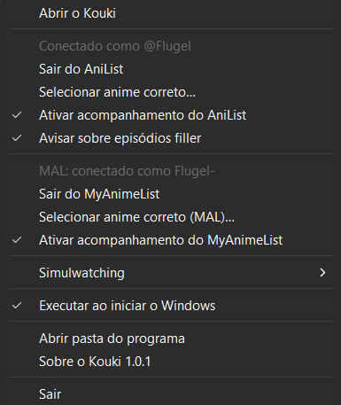
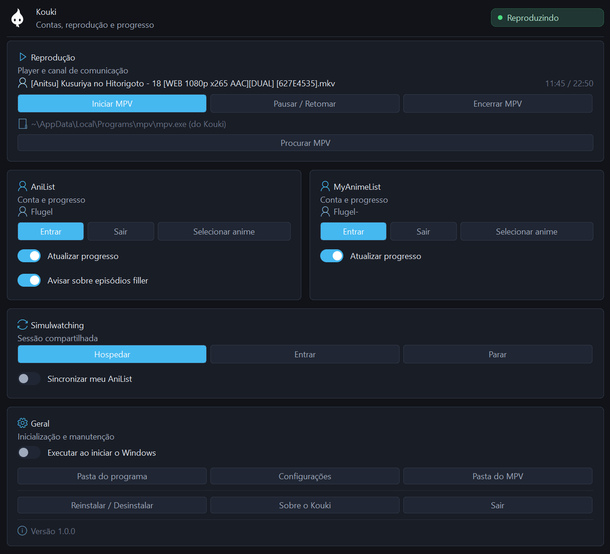
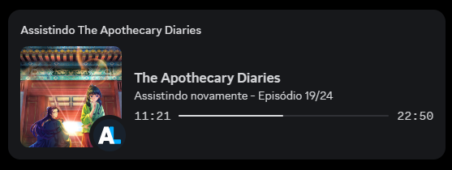

# Kouki

**Contas, reprodução e progresso** — mostra o que está tocando com o título, o episódio, a capa e o progresso, e sincroniza com AniList e MyAnimeList. Tudo em português. Esta branch inclui Windows e Linux (AppImage).

> Fork do [Koushin](https://github.com/hyuzipt/Koushin). As configurações antigas do Koushin são migradas automaticamente para `%APPDATA%\Kouki` na primeira execução.

Repositório: <https://github.com/flugeru/Kouki>

---

## Capturas de tela

### Bandeja do sistema



### Janela principal



### Rich presence



---

## Linux (AppImage)

O [fluxo Linux AppImage](https://github.com/flugeru/Kouki/actions/workflows/linux-appimage.yml) gera versões para x86_64 e ARM64. O Kouki usa o `mpv` instalado no Linux, controlado por socket Unix, e abre a interface local no navegador padrão. Consulte o [guia de instalação e compilação para Linux](README-Linux.md) para dependências e instruções.

## Windows (instalador)

Execute **`Kouki-1.1.0-Setup.exe`**.

O instalador é *per-user*: grava em `%LOCALAPPDATA%\Programs\Kouki` e **não pede privilégios de administrador**.

| Caminho | Conteúdo |
|---|---|
| `%LOCALAPPDATA%\Programs\Kouki` | programa, ícone, `THIRD-PARTY-NOTICES.md` |
| `%LOCALAPPDATA%\Programs\Kouki\mpv` | MPV empacotado (componente opcional) |
| `%APPDATA%\Kouki` | `auth.json` (configurações e tokens), `kouki.log` |

Na página de tarefas você pode escolher:

- **componente MPV** — desmarque para instalar só o programa;
- **atalho na Área de Trabalho**;
- **iniciar com o Windows**.

Para desinstalar: *Configurações → Aplicativos → Kouki*. Suas configurações e tokens são preservados.

---

## Primeiro uso

O MPV já vem configurado — perfil `high-quality`, `uosc`, shaders, codecs e `hwdec` — com o canal IPC ligado para o Kouki ler.

Na janela principal, **Reprodução → Iniciar MPV** sobe o player empacotado. Isso garante que o `portable_config/` seja carregado: o mpv só procura essa pasta ao lado do próprio executável.

---

## Janela principal e bandeja

| Seção | Ações |
|---|---|
| Reprodução | Iniciar/Encerrar MPV, Pausar/Retomar, procurar MPV, arquivo e posição atuais |
| AniList | Entrar/Sair, selecionar anime correto, acompanhar progresso, aviso de filler |
| MyAnimeList | Entrar/Sair, selecionar anime correto, acompanhar progresso |
| Simulwatching | Hospedar/Entrar/Parar, sincronizar AniList |
| Geral | Iniciar com o Windows, abrir as pastas do app e dos dados, Sobre, Sair |

- **Fechar** e **minimizar** ocultam a janela; o Kouki **continua na bandeja**.
- **bandeja → "Abrir o Kouki"** traz a janela de volta.
- Só **"Sair"** encerra de fato — e nesse momento o MPV que o Kouki iniciou é finalizado.

A bandeja continua sendo o caminho rápido: as mesmas ações, em um clique.

---

## Integração com o MPV

O MPV roda como **processo separado** e o Kouki fala com ele pelo **JSON IPC do próprio mpv**, exposto como named pipe (`\\.\pipe\mpv-pipe`).

O MPV empacotado é o build do usuário (shinchiro) e **não** traz `libmpv-2.dll`, então bindings de libmpv não são uma opção. O JSON IPC é a superfície de integração **oficial** para um player externo, funciona com o MPV empacotado e com qualquer MPV que o usuário já tenha, e não exige toolchain C.

---

## Dependências

| Módulo | Licença |
|---|---|
| `github.com/lxn/walk` | MIT |
| `github.com/Microsoft/go-winio` | MIT |
| `github.com/getlantern/systray` | Apache-2.0 |
| `github.com/5rahim/habari` | MIT |
| `github.com/huin/goupnp`, `github.com/jackpal/go-nat-pmp` | MIT |
| `golang.org/x/sys` | BSD-3 |

---

## Compilando no Windows

Requisitos: **Go 1.26+**. O instalador também requer **Inno Setup 6** e
`assets\mpv\mpv.exe` (prepare com `-MpvSource` quando ainda não estiver presente).

```powershell
.\tools\build.ps1 -MpvSource C:\caminho\para\mpv  # pacote com MPV
.\tools\build.ps1 -SkipInstaller                  # apenas Kouki.exe
```

Antes de compilar, execute `go test ./...` e `go vet ./...`. Para um pacote
com MPV, passe `-MpvSource C:\caminho\para\mpv`. Sem esse parâmetro, o
script reutiliza somente o conteúdo já preparado em `assets\mpv` e não
copia arquivos do perfil do usuário. Com `-SkipInstaller`, o executável
pode usar uma instalação externa do MPV.

Saída em `dist\` quando o instalador é incluído: `Kouki-1.1.0-Setup.exe`,
`COMO-INSTALAR.txt`, `kouki.ico`, `THIRD-PARTY-NOTICES.md`.

---

## Licenças

Kouki: MIT. O MPV empacotado é GPLv2+ de terceiros — ver [`THIRD-PARTY-NOTICES.md`](./THIRD-PARTY-NOTICES.md).
